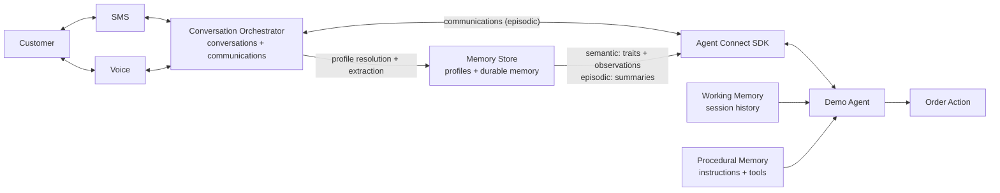

# Conversational Agent Memory

This repository contains the SMS and Voice application for Building AI Agents That Remember.

See [RUNBOOK.md](RUNBOOK.md) for setup and project operations.


## Session details

**Title**: Building AI Agents That Remember

**Abstract**:

Agents don’t remember simply because a transcript exists. Useful memory requires deliberate choices about who is speaking, what should be retained, how memories change over time, and which context matters now.

In this live demo, we’ll explore how to turn fragmented interactions into durable memory. We’ll examine practical approaches to capturing context, retrieving it when needed, and using it to create more relevant interactions across channels.

Attendees will leave with a practical framework for building conversational agents that maintain continuity, adapt over time, and deliver personalised experiences across interactions.


## Demo architecture



A customer interacts over SMS or Voice channel. Conversation Orchestrator captures those interactions as
communications and groups them into a cross-channel conversation. Its linked Memory Store
resolves customer profiles and stores traits, observations, and summaries. Agent Connect
delivers communications and recalled context to the demo agent. The application supplies
working memory through session history and procedural memory through instructions and tools.
Following the [CoALA framework](https://arxiv.org/pdf/2309.02427), the four memory types are
working (session history), episodic (communications and summaries), semantic (traits and
observations), and procedural (instructions and tools).

## Project structure

```
conversational-agent-memory/
├── src/conversation_agent/ # Demo app
├── scripts/                # Setup and helper scripts
├── assets/                 # Dummy data
├── RUNBOOK.md              # Setup and demo guide
└── run.sh                  # Run the app
```


## Prerequisites

- [Python 3.11 or newer](https://www.python.org/downloads/)
- An [OpenAI API key](https://platform.openai.com/api-keys)
- A [Twilio account](https://www.twilio.com/try-twilio) with an Account SID, Auth Token, and [API key](https://www.twilio.com/docs/iam/api-keys)
- A [Twilio phone number](https://www.twilio.com/docs/phone-numbers) that supports Voice and SMS
- [ngrok](https://ngrok.com/download) or another public HTTPS/WSS tunnel to local port `8000`
- A phone for testing calls and SMS


## Resources

- [Project runbook](RUNBOOK.md)
- [Twilio Agent Connect Python SDK](https://github.com/twilio/twilio-agent-connect-python)
- [Conversation Memory overview](https://www.twilio.com/docs/conversations/memory)
- [Conversation Orchestrator overview](https://www.twilio.com/docs/conversations/orchestrator)
- [Conversation Relay overview](https://www.twilio.com/docs/voice/conversationrelay)
- [OpenAI Agents SDK](https://developers.openai.com/api/docs/guides/agents/sdk)


## License

This project is licensed under the [MIT License](LICENSE).
