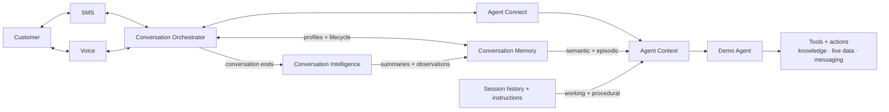

# Conversational Agent Memory

This repository contains the SMS and Voice application for Building AI Agents That Remember.

See [RUNBOOK.md](RUNBOOK.md) for setup and project operations.


## Session details

**Title**: Building AI Agents That Remember

**Abstract**:

Agents don’t remember simply because a transcript exists. Useful memory requires deliberate choices about who is speaking, what should be retained, how memories change over time, and which context matters now.

In this live demo, we’ll explore how to turn fragmented interactions into durable memory. We’ll examine practical approaches to capturing context, retrieving it when needed, and using it to create more relevant interactions across channels.

Attendees will leave with a practical framework for building conversational agents that maintain continuity, adapt over time, and deliver personalised experiences across interactions.


## Demo architecture



A customer interacts with the demo agent over SMS or Voice. Conversation Orchestrator captures
each communication, groups interactions into a cross-channel conversation, and resolves the
customer profile through Conversation Memory. Agent Connect connects those conversations to the
agent runtime, where relevant customer memory is combined with the current session and agent
instructions. The agent can then use external tools for knowledge, live data, messaging, and other
actions without treating that current information as durable memory. When a conversation ends,
Conversation Intelligence can analyze it to produce summaries and observations for future
interactions.

Following the [CoALA framework](https://arxiv.org/pdf/2309.02427), this demo maps the
four memory types as follows:

- **Working memory:** the current conversation session and relevant recalled context.
- **Episodic memory:** previous communications and conversation summaries.
- **Semantic memory:** customer traits and durable observations.
- **Procedural memory:** agent instructions and available tools.


## How memory informs a conversation



The agent combines relevant long-term memory with the current session before checking live data
and taking an action. When the conversation ends, durable summaries and observations can inform
future interactions. See the [standalone conversation flow](diagrams/conversation-memory-flow.html)
for a larger view and JPG export.

## Project structure

```
conversational-agent-memory/
├── src/conversation_agent/
│   ├── main.py             # FastAPI app and SMS/Voice channel wiring
│   ├── agent.py            # Agent instructions, sessions, and model execution
│   ├── memory_models.py    # Conversation Memory data models
│   ├── order_store.py      # Simulated live order state
│   └── tools/
│       ├── memory.py       # Customer-memory recall
│       ├── knowledge.py    # Enterprise Knowledge search
│       ├── orders.py       # Live order tools
│       ├── messaging.py    # Outbound messaging tools
│       └── provider.py     # Conversation-scoped tool assembly
├── diagrams/               # Architecture, sequence, and memory-flow diagrams
├── assets/                 # Fictional bakery knowledge
├── scripts/                # Setup, seeding, verification, and cleanup helpers
├── README.md               # Architecture and project overview
├── RUNBOOK.md              # Setup, demo, and cleanup instructions
├── pyproject.toml          # Python package and development dependencies
└── run.sh                  # Run the local application
```


## Prerequisites

- [Python 3.11 or newer](https://www.python.org/downloads/)
- An [OpenAI API key](https://platform.openai.com/api-keys)
- A [Twilio account](https://www.twilio.com/try-twilio) with an Account SID, Auth Token, and [API key](https://www.twilio.com/docs/iam/api-keys)
- A [Twilio phone number](https://www.twilio.com/docs/phone-numbers) that supports Voice and SMS
- [ngrok](https://ngrok.com/download) or another public HTTPS/WSS tunnel to local port `8000`
- A phone for testing calls and SMS


## Resources

- [Project runbook](RUNBOOK.md)
- [Twilio Agent Connect Python SDK](https://github.com/twilio/twilio-agent-connect-python)
- [Conversation Memory overview](https://www.twilio.com/docs/conversations/memory)
- [Conversation Orchestrator overview](https://www.twilio.com/docs/conversations/orchestrator)
- [Conversation Relay overview](https://www.twilio.com/docs/voice/conversationrelay)
- [OpenAI Agents SDK](https://developers.openai.com/api/docs/guides/agents/sdk)


## License

This project is licensed under the [MIT License](LICENSE).
