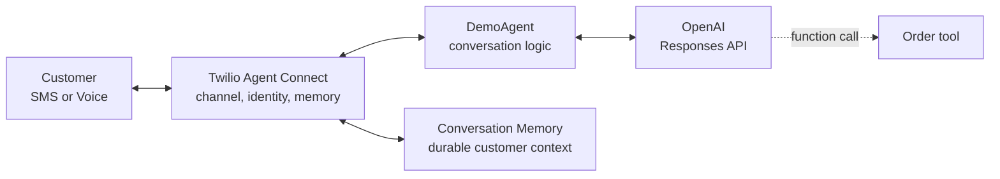

# Conversational Agent Memory

This repository contains the SMS and Voice application for Designing AI Agents That Remember.
See [DEMO.md](DEMO.md) for the live demo sequence.

## Session details

**Title**: Designing AI Agents That Remember

**Abstract**:

Agents don’t remember simply because a transcript exists. Useful memory requires deliberate choices: who is speaking, what should be retained, how memories change over time, and which context matters now.

In this live demo, we’ll explore how conversational agents can turn fragmented interactions into useful, durable memory. We’ll examine practical approaches to capturing context, retrieving it when needed, and using it to create more relevant interactions across channels.

Attendees will leave with a practical framework for designing agents that maintain continuity, adapt over time, and deliver personalised conversations, instead of starting from scratch with every interaction.

## Demo architecture



SMS and Voice share one agent. Agent Connect resolves identity and memory, while the OpenAI
Responses API handles conversation state and tool calls.

## Project structure

```
conversational-agent-memory/
├── src/conversation_agent/
│   ├── main.py          # Stable FastAPI, SMS, Voice, and Agent Connect wiring
│   ├── demo.py          # Starting point edited live during the demo
│   └── order_tool.py    # In-memory order action introduced in stage 5
├── demo_stages/         # Complete reference implementations for stages 1–5
├── scripts/             # Provisioning, seed, verification, and cleanup commands
├── DEMO.md              # Presenter script and live-edit sequence
├── .env.example         # Required configuration values
└── run.sh               # Local application entry point
```

## Prerequisites

Before you begin, you need:

- Python 3.11 or later.
- A Twilio account with a Voice and SMS-capable phone number.
- A Twilio Account SID, Auth Token, API key, and API secret.
- An OpenAI API key.
- A public HTTPS domain that forwards to local port `8000`. Voice also uses the equivalent
  secure WebSocket connection.

## Quickstart

### 1. Install dependencies

Create a virtual environment and install the project.

```bash
python -m venv .venv
source .venv/bin/activate
pip install -e ".[dev]"
```

### 2. Configure the environment

Copy the example environment file.

```bash
cp .env.example .env
```

Set the OpenAI key, Twilio credentials, Twilio phone number, demo customer phone number,
and public domain in `.env`. Leave `TWILIO_MEMORY_STORE_ID` and
`TWILIO_CONVERSATION_CONFIGURATION_ID` empty for now.

### 3. Provision Twilio resources

Create the Conversation Memory store and Conversation Orchestrator configuration.

```bash
python -m scripts.setup
```

Copy the two generated IDs into the matching fields in `.env`.

### 4. Configure the Voice webhook

In the Twilio Console, configure the phone number's incoming Voice webhook to send a `POST`
request to `https://<your-domain>/twiml`.

### 5. Prepare the demo data

Seed a known customer profile and run the preflight verification.

```bash
python -m scripts.seed_demo
python -m scripts.verify_demo
```

### 6. Run the application

```bash
./run.sh
```

Open `http://localhost:8000/health` to confirm that the server is running. During the demo,
edit `src/conversation_agent/demo.py`, stop the server, and run `./run.sh` again after each
stage.

## Development

Run the lint checks before presenting:

```bash
ruff check src scripts demo_stages
```

## Resources

- [Live demo sequence](DEMO.md)
- [Twilio Agent Connect Python SDK](https://github.com/twilio/twilio-agent-connect-python)
- [Conversation Memory overview](https://www.twilio.com/docs/conversations/memory)
- [Conversation Orchestrator overview](https://www.twilio.com/docs/conversations/orchestrator)
- [Conversation Relay overview](https://www.twilio.com/docs/voice/conversationrelay)
- [OpenAI Responses API reference](https://developers.openai.com/api/reference/resources/responses/methods/create)

## License

This project is licensed under the [MIT License](LICENSE).
