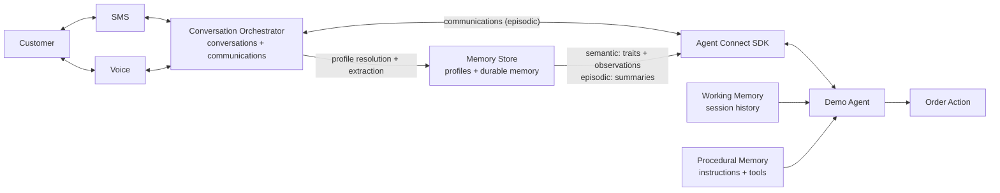

# Conversational Agent Memory

This repository contains the SMS and Voice application for Building AI Agents That Remember.
See [DEMO.md](DEMO.md) for the live demo sequence.

## Session details

**Title**: Building AI Agents That Remember

**Abstract**:

Agents don’t remember simply because a transcript exists. Useful memory requires deliberate choices about who is speaking, what should be retained, how memories change over time, and which context matters now.

In this live demo, we’ll explore how to turn fragmented interactions into durable memory. We’ll examine practical approaches to capturing context, retrieving it when needed, and using it to create more relevant interactions across channels.

Attendees will leave with a practical framework for building conversational agents that maintain continuity, adapt over time, and deliver personalised experiences across interactions.

## Demo architecture



A customer interacts over SMS or Voice channel. Conversation Orchestrator captures those interactions as
communications and groups them into a cross-channel conversation. Its linked Memory Store
resolves customer profiles and stores traits, observations, and summaries. Agent Connect
delivers communications and recalled context to the demo agent. The application supplies
working memory through session history and procedural memory through instructions and tools.
Following the [CoALA framework](https://arxiv.org/pdf/2309.02427), the four memory types are
working (session history), episodic (communications and summaries), semantic (traits and
observations), and procedural (instructions and tools).

> **Zero Data Retention:** `ModelSettings(store=False)` explicitly disables response storage,
> although OpenAI enforces this automatically for ZDR projects. `set_tracing_disabled(True)`
> separately prevents the Agents SDK from sending hosted traces.

## Project structure

```
conversational-agent-memory/
├── src/conversation_agent/
│   ├── main.py          # App and channel wiring
│   ├── agent.py         # Agent code edited live
│   ├── memory_models.py # Four CoALA memory types
│   └── order_tool.py    # Example agent action
├── scripts/             # Setup and demo-data utilities
├── DEMO.md              # Presenter guide
├── .env.example         # Environment template
└── run.sh               # Start the app
```

## Prerequisites

Before you begin, you need:

- [Python 3.11+](https://www.python.org/downloads/).
- An [OpenAI API key](https://platform.openai.com/api-keys).
- A Twilio account with [API credentials](https://www.twilio.com/docs/iam/api-keys) and a
  [Voice and SMS-capable number](https://www.twilio.com/docs/phone-numbers).
- Access to [Twilio Conversations](https://www.twilio.com/docs/conversations).
- A public HTTPS/WSS tunnel to local port `8000` and a phone for testing.

## Quickstart

### 1. Install dependencies

Create a virtual environment and install the project.

```bash
python -m venv .venv
source .venv/bin/activate
pip install -e ".[dev]"
```

### 2. Configure the environment

Copy the example environment file.

```bash
cp .env.example .env
```

Set the OpenAI key, Twilio credentials, Twilio phone number, demo customer phone number,
and public domain in `.env`. Leave `TWILIO_MEMORY_STORE_ID` and
`TWILIO_CONVERSATION_CONFIGURATION_ID` empty for now.

### 3. Provision Twilio resources

Create the Conversation Memory store and Conversation Orchestrator configuration.

```bash
python -m scripts.setup
```

Copy the two generated IDs into the matching fields in `.env`.

### 4. Configure the Voice webhook

In the Twilio Console, configure the phone number's incoming Voice webhook to send a `POST`
request to `https://<your-domain>/twiml`.

### 5. Prepare the demo data

Seed a known customer profile and run the preflight verification.

```bash
python -m scripts.seed_demo
python -m scripts.verify_demo
```

### 6. Run the application

```bash
./run.sh
```

Open `http://localhost:8000/health` to confirm that the server is running. During the demo,
edit `src/conversation_agent/agent.py`, stop the server, and run `./run.sh` again after each
stage.

## Development

Run the lint checks before presenting:

```bash
ruff check src scripts demo_stages
```

## Resources

- [Live demo sequence](DEMO.md)
- [Twilio Agent Connect Python SDK](https://github.com/twilio/twilio-agent-connect-python)
- [Conversation Memory overview](https://www.twilio.com/docs/conversations/memory)
- [Conversation Orchestrator overview](https://www.twilio.com/docs/conversations/orchestrator)
- [Conversation Relay overview](https://www.twilio.com/docs/voice/conversationrelay)
- [OpenAI Agents SDK](https://developers.openai.com/api/docs/guides/agents/sdk)

## License

This project is licensed under the [MIT License](LICENSE).
